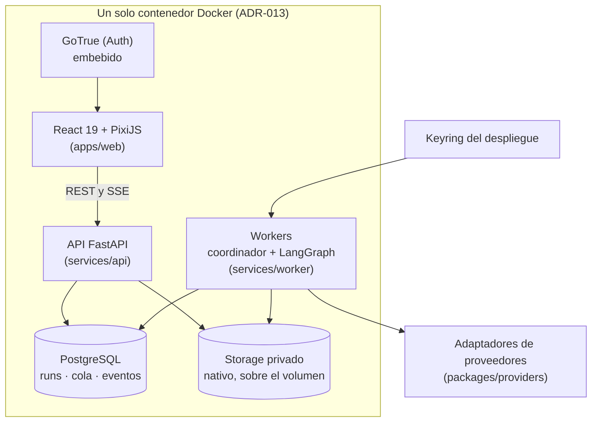
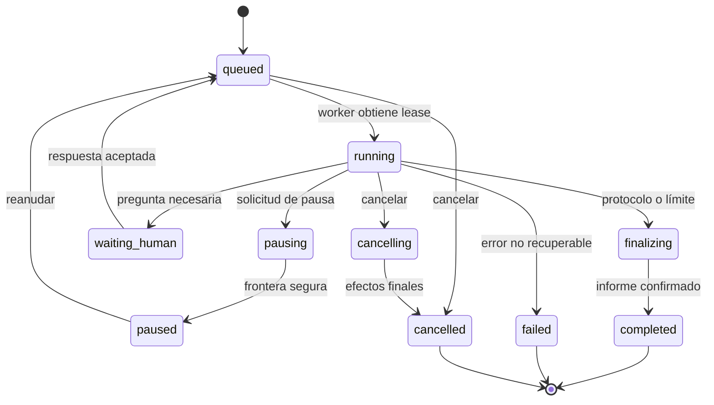

<p align="center">
  <a href="#-backlog-y-roadmap">
    
  </a>
</p>

<h1 align="center">🔮 Warlock Oráculo</h1>

<p align="center"><b>Un centro de deliberación multiagente donde una idea se convierte en argumentos, contraargumentos, preguntas y decisiones revisables, dentro de salas animadas con personajes originales de oficina.</b></p>

<p align="center">
  
  <a href="LICENSE"></a>
  <a href="../../milestones"></a>
</p>

<p align="center">
  
  
  
  
  
  
  
  
</p>

<p align="center">
  <a href="#-qué-es-esto"><b>Qué es esto</b></a> ·
  <a href="#-las-cinco-salas"><b>Las cinco salas</b></a> ·
  <a href="#-principios-no-negociables"><b>Principios</b></a> ·
  <a href="#-qué-no-es-este-producto"><b>Qué no es</b></a> ·
  <a href="#-arquitectura"><b>Arquitectura</b></a> ·
  <a href="#-estado-actual"><b>Estado actual</b></a> ·
  <a href="#-backlog-y-roadmap"><b>Backlog y roadmap</b></a> ·
  <a href="#-cómo-contribuir"><b>Cómo contribuir</b></a>
</p>

---

### Un chatbot responde desde una sola voz. Esto no.

Pedirle a un chatbot que evalúe una idea te da una opinión. Cambiar el prompt no hace visible qué supuestos comparte esa opinión ni qué objeciones quedaron sin resolver. **Warlock Oráculo convoca una sala** &mdash; un Tribunal, una Mesa de perspectivas, un Consejo de inversión, un Laboratorio de resiliencia o una Mesa socrática &mdash; con roles que tienen criterios de evaluación distintos, a veces modelos distintos, y que deben responder a las objeciones de los demás antes de llegar a una conclusión. Observas el intercambio en vivo, en una oficina isométrica con personajes propios, y te quedas con un expediente: recomendación, desacuerdos que no se resolvieron, evidencia citada y próximos pasos.

El sistema no descubre una verdad por autoridad. Produce perspectivas generadas por modelos y te deja rastrear qué información y qué criterio sostiene cada afirmación. La decisión la conservas tú.

<table>
  <tr>
    <td align="center" width="20%"><h2>5</h2><sub>salas deliberativas,<br/>cada una con su protocolo</sub></td>
    <td align="center" width="20%"><h2>28</h2><sub>presets de rol sobre<br/>6 arquetipos visuales</sub></td>
    <td align="center" width="20%"><h2>14 · 84 · 420</h2><sub>epics · issues padre ·<br/>subissues del backlog</sub></td>
    <td align="center" width="20%"><h2>12</h2><sub>ADR que fijan las<br/>decisiones de arquitectura</sub></td>
    <td align="center" width="20%"><h2>0</h2><sub>certezas inventadas:<br/>desconocido ≠ cero</sub></td>
  </tr>
</table>

---

## 🎯 Qué es esto

| Pieza | Qué hace |
| --- | --- |
| 🏛️ **Cinco salas con protocolo propio** | El Juicio (Tribunal de ideas), Los Sombreros Pensantes (Mesa de perspectivas), El Shark Tank (Consejo de inversión), Red Team vs. Blue Team (Laboratorio de resiliencia) y La Mesa Socrática. Cada una tiene participantes, fases, reglas de intervención y un esquema de salida distinto, no un único prompt reciclado. |
| 🧑‍💼 **Personajes con responsabilidades reales** | Juez, Fiscal, Defensa, Jurado, Financiero, Técnico, Escéptico, Sombrero Rojo, Sombrero Negro, Red Team, Blue Team, Maestro socrático... 28 presets de rol sobre 6 arquetipos visuales originales ("Office Beans"), nunca un recoloreado de un personaje de videojuego ajeno. |
| 🗣️ **Deliberación estructurada, no texto libre** | Cada mensaje tiene objetivo, destinatario, tipo (apertura, objeción, réplica, pregunta, síntesis...) y relación explícita con mensajes anteriores. Las afirmaciones se etiquetan: aportada por el usuario, respaldada por fuente, inferencia, opinión, hipotética o sin verificar. |
| ⏸️ **Control humano real** | Pausar, preguntar, aportar evidencia nueva, cambiar una personalidad en una frontera segura, o abrir un run derivado (fork) sin destruir la sesión original. |
| 🔁 **Ejecución durable, no atada a una petición HTTP** | Cola en PostgreSQL con leases y *fencing tokens*, checkpoints de LangGraph, event log append-only. Matar un worker a mitad de un debate no duplica mensajes ni pierde lo ya confirmado. |
| 🔑 **BYOK real** | OpenAI, Anthropic, Gemini, DeepSeek, cualquier endpoint compatible OpenAI, y modelos locales vía Ollama. Las llaves se cifran en la aplicación (AEAD), nunca llegan al navegador, a un log o a una exportación. |
| 💸 **Gasto nunca fantasma** | Reservas de presupuesto antes de cada llamada, `estimated` / `reported` / `unknown` siempre distinguibles. Un costo desconocido nunca se muestra como `$0`. |
| 🎬 **Replay sin volver a pagar** | Vuelve a ver cualquier run, acelerado o cuadro a cuadro, sin una sola llamada nueva a un proveedor de IA. |

---

## 🥊 Diferenciadores

| Capacidad | Comportamiento observable |
| --- | --- |
| Deliberación estructurada | Cada intervención tiene objetivo, destinatario y relación explícita con argumentos anteriores &mdash; no es un chat que se desplaza hacia abajo. |
| Personajes visibles | El mismo evento actualiza la conversación, el estado del personaje en escena y el panel de inspección, a la vez. |
| Múltiples perspectivas reales | Roles con criterios de evaluación distintos; pueden correr sobre modelos distintos y proveedores distintos en la misma sesión. |
| Rigor explícito | Hecho aportado, afirmación verificada, inferencia y opinión tienen etiquetas distintas, visibles en la UI y en el export. |
| Control humano real | Pausar, preguntar, aportar evidencia, revisar perfiles y abrir una rama nueva sin destruir la sesión original. |
| Recuperación sin fantasmas | Reiniciar un worker no borra mensajes confirmados ni duplica conclusiones ni vuelve a cobrar una llamada ya resuelta. |
| Transparencia de gasto | Costo observado y estimado se muestran por separado; precios y capacidades de cada proveedor están versionados. |

---

## 🎭 Las cinco salas

| Sala | Pregunta guía | Participantes | Produce |
| --- | --- | --- | --- |
| **El Juicio** <br/><sub>"Tribunal de ideas"</sub> | ¿Esta propuesta se sostiene bajo los criterios establecidos? | Juez, Fiscal, Defensa, 1–3 Jurados, Secretario | Veredicto (`admisible` · `admisible_con_condiciones` · `requiere_evidencia` · `no_recomendado`), votos del jurado, condiciones y acta |
| **Los Sombreros Pensantes** <br/><sub>"Mesa de perspectivas"</sub> | ¿Qué vemos al separar datos, emociones, riesgos, beneficios, alternativas y dirección? | Blanco, Rojo, Negro, Amarillo, Verde, Azul, Warlock | Mapa de perspectivas, oportunidades, riesgos, alternativas y experimento recomendado |
| **El Shark Tank** <br/><sub>"Consejo de inversión"</sub> | ¿Qué tendría que demostrarse para que esta idea merezca recursos? | Financiero, Técnico, Marketing, Escéptico, Moderador | `avanzar` · `experimentar` · `reformular` · `detener`, unit economics con fórmula visible, plan de validación |
| **Red Team vs. Blue Team** <br/><sub>"Laboratorio de resiliencia"</sub> | ¿Cómo falla este diseño y qué medidas reducen el riesgo? | Red Arquitectura/Abuso/Operación, Blue Seguridad/Plataforma/Producto, Árbitro | Escenarios de fallo, controles, riesgo residual y pruebas sugeridas (revisión de diseño, no ataques reales) |
| **La Mesa Socrática** <br/><sub>"Exploración socrática"</sub> | ¿Qué necesitamos aclarar antes de afirmar que entendemos el problema? | Maestro, Explorador, Contrapunto, Sintetizador | Árbol de preguntas, conceptos aclarados, contradicciones y conclusiones provisionales |

Las cinco comparten expediente, motor de ejecución, transporte de eventos, escena y panel de resultados: no son cinco aplicaciones distintas, son cinco `RoomTemplate` versionados sobre el mismo runtime (`packages/orchestration/`, `packages/scene-runtime/`).

<details>
<summary><b>📄 Ejemplo de expediente por sala</b></summary>
<br/>

- **El Juicio:** adoptar una arquitectura de microservicios para un equipo de tres desarrolladores. El Fiscal examina operación y costo, la Defensa modularidad, el Jurado evalúa contra la rúbrica acordada.
- **Los Sombreros Pensantes:** una idea de producto nueva, separando qué es dato observado, qué es intuición, qué riesgo real existe y qué alternativa no se ha probado todavía.
- **El Shark Tank:** un negocio con cifras parciales, donde el Financiero calcula sensibilidad con fórmulas visibles y el Escéptico busca falsar la hipótesis de demanda.
- **Red Team vs. Blue Team:** el diseño de un sistema con sus activos y supuestos declarados; es revisión de diseño sobre información aportada, nunca un ataque a un host real.
- **La Mesa Socrática:** una pregunta todavía ambigua, donde el Maestro reformula antes de dejar que el Explorador y el Contrapunto aporten casos y contraejemplos.

</details>

<details>
<summary><b>💬 Contrato de un mensaje deliberativo</b></summary>
<br/>

Cada intervención de un agente, sin excepción, se ajusta a este contrato (dominio puro, sin depender de ningún proveedor):

```
message_id, turn_id, agent_id, audience, kind, reply_to,
phase, content, claims, evidence_refs, objection_refs,
proposals, questions, completion_status
```

- `kind` admite: apertura, argumento, objeción, réplica, pregunta, evaluación, síntesis.
- `audience` admite: sala completa, equipo, o agentes concretos.
- Cada `claim` lleva una categoría: `user_provided` · `source_supported` · `inference` · `opinion` · `hypothetical` · `unverified`. Tener una URL no verifica una afirmación; `source_supported` exige un fragmento localizable y una relación revisable.
- No se solicitan ni se muestran cadenas de pensamiento privadas: la aplicación conserva explicaciones y argumentos publicables, no un "razonamiento interno" del modelo.

</details>

<details>
<summary><b>🚀 Contrato de creación de un run</b></summary>
<br/>

```json
{
  "project_id": "00000000-0000-0000-0000-000000000001",
  "case_version_id": "00000000-0000-0000-0000-000000000002",
  "room": { "slug": "tribunal", "version": "1.0.0" },
  "agents": [
    { "instance_id": "judge", "profile_version_id": "profile-judge-v1", "credential_ref": "cred-personal-1", "model": "configured-model" }
  ],
  "limits": { "max_rounds": 3, "max_turns": 24, "max_duration_seconds": 900, "max_output_tokens_per_turn": 1200, "estimated_budget_usd": "2.00" },
  "language": "es",
  "execution_mode": "live"
}
```

`POST /v1/runs` crea el run, su snapshot de configuración, su primer evento y su job durable **en una sola transacción** antes de responder `202`. El servidor resuelve precio y capacidades; nunca acepta un costo calculado por el cliente como presupuesto ejecutado.

</details>

<details>
<summary><b>📡 Sobre de un evento del stream</b></summary>
<br/>

```json
{
  "schema_version": "1.0",
  "event_id": "00000000-0000-0000-0000-000000000010",
  "run_id": "00000000-0000-0000-0000-000000000020",
  "seq": 42,
  "type": "message.delta",
  "occurred_at": "2026-10-11T20:00:00Z",
  "agent_id": "judge",
  "turn_id": "turn-06",
  "origin": "live",
  "payload": { "message_id": "msg-06", "attempt": 1, "revision": 1, "chunk_index": 3, "text": "La condición principal es" }
}
```

`seq` es orden de persistencia, no orden de reloj; se asigna al confirmar en base de datos, nunca en el cliente. El cliente SSE lee el snapshot (`snapshot_seq`), se conecta con `after_seq=snapshot_seq` y hace catch-up paginado antes del tail en vivo: así nunca se pierde el evento que ocurre entre leer el snapshot y abrir el stream.

</details>

---

## 🧠 Principios (no negociables)

Reglas aplicadas en código, no solo en el prompt &mdash; ver [`AGENTS.md`](AGENTS.md) y la sección 4–7 de la especificación:

1. **Persistir antes de emitir.** Ningún mensaje se muestra como confirmado sin estar escrito en la base de datos primero; ninguna llamada a un proveedor ocurre sin su intención registrada (*operation ledger*).
2. **Un solo coordinador por run.** LangGraph detrás de una interfaz propia; no hay un segundo scheduler compitiendo por el mismo turno.
3. **Desconocido no es cero.** Costo, capacidad o verificación desconocidos se muestran como `unknown`, nunca como `$0` o como falso.
4. **Afirmación sin fuente localizable no es un hecho verificado.** `user_provided`, `source_supported`, `inference`, `opinion`, `hypothetical`, `unverified` son categorías distintas y visibles.
5. **Un voto es una evaluación ordinal, nunca una probabilidad de verdad.** Y si varios jurados comparten el mismo modelo subyacente, eso se muestra: no se presenta como consenso de expertos independientes.
6. **Las simulaciones se etiquetan `origin: "demo"` desde su origen** y lo siguen estando en replay y en exportaciones. Un escenario grabado nunca se presenta como ejecución real.
7. **Secretos cifrados en la aplicación (AEAD), nunca en claro fuera del worker.** Ni en el navegador, ni en logs, ni en checkpoints, ni en exportaciones.
8. **Aislamiento real entre workspaces.** RLS probado con al menos dos workspaces y los cuatro roles de membresía (Owner, Admin, Member, Viewer), no solo una columna `workspace_id` de buena fe.
9. **No exactly-once con proveedores externos.** Un reintento puede cobrar una llamada cuya respuesta se perdió antes de persistirse; eso se reconoce (`outcome_unknown`) en vez de prometer lo imposible.

---

## 🚫 Qué NO es este producto

Para que quede explícito y no se infle el alcance con el tiempo:

- No es una plataforma de trading ni ejecuta cobros.
- No ejecuta scripts arbitrarios enviados por usuarios, ni código de un grafo definido en el navegador.
- El Laboratorio de resiliencia es **revisión de diseño sobre información aportada**, no automatización de ataques reales contra hosts.
- No publica conclusiones automáticamente ni se integra de forma obligatoria con n8n.
- No depende de que exista Grimorio o Sentinel: la relación con el resto del ecosistema WarlockCode es conceptual (Grimorio organiza conocimiento, Oráculo organiza deliberación, Sentinel podría aportar hallazgos como evidencia a futuro) y **el producto funciona completo por sí solo**.
- No promete un techo monetario exacto cuando el precio de un proveedor es desconocido: en ese caso bloquea el modo de límite estricto o exige autorización explícita basada en tokens.

---

## 🏗️ Arquitectura



| Capa | Decisión | Por qué |
| --- | --- | --- |
| Frontend | React 19 + TypeScript estricto + Vite + TailwindCSS | Servido por la propia API como estático; ecosistema compartido con el resto de productos WarlockCode |
| Escena | PixiJS (versión fijada en lockfile) | Sprites, atlas, cámara y composición 2.5D |
| API | Python 3.13 + FastAPI + Pydantic v2 | Contratos tipados, cercanía al motor de IA |
| Orquestación | LangGraph detrás de interfaz propia | Fases, checkpoints, ramas y pausas humanas sin acoplar el dominio a la librería |
| Trabajo durable | Cola en PostgreSQL + proceso worker | Un debate no muere si cae la petición HTTP que lo inició |
| Datos | PostgreSQL embebido en el contenedor (o Supabase administrado como alternativa), RLS | Integridad transaccional y permisos reales, no solo de UI |
| Identidad | GoTrue (el Auth open source de Supabase) embebido, o Supabase Cloud como alternativa | Google y correo, sesión renovable, sin depender de un servicio externo por defecto |
| Secretos | Cifrado AEAD en aplicación + keyring externo | Separar datos almacenados de claves maestras (`ADR-006`) |
| Observabilidad | OpenTelemetry + logs estructurados sin contenido sensible | Correlación de API, run, turno y proveedor |
| **Despliegue** | **Una sola imagen Docker** (web + API + worker + PostgreSQL + GoTrue bajo un supervisor de procesos). Cloudflare Pages + Coolify queda como ruta alternativa para quien prefiera escalar servicios por separado. | `docker run` levanta el producto completo sin infraestructura externa (`ADR-013`) |
| Arte | `tools/asset-forge/`: pipeline asistido por IA con cola de revisión humana y procedencia obligatoria | Producir los ~1.632 frames objetivo sin perder control de calidad (`ADR-014`) |

<details>
<summary><b>🔄 Máquina de estados de un run</b></summary>
<br/>



Un estado terminal (`completed`, `failed`, `cancelled`) no se reabre: un reintento crea un run derivado. Transiciones concurrentes usan `state_version` con control optimista; toda transición escribe su evento en la misma transacción.

</details>

<details>
<summary><b>📁 Estructura del monorepo</b></summary>
<br/>

```text
warlock-oraculo/
├── apps/web/                  # React 19 + PixiJS: lobby, escena, inspector, replay
├── services/api/              # FastAPI: REST + SSE, auth, permisos
├── services/worker/           # Cola, leases, fencing, coordinador LangGraph
├── packages/domain-python/    # Run, Turn, DebateMessage, Evidence, Budget (sin deps de framework)
├── packages/orchestration/    # Grafos LangGraph, nodos, checkpointer privado
├── packages/providers/        # Adaptadores normalizados de proveedores de IA
├── packages/contracts/        # OpenAPI + JSON Schema → tipos TypeScript generados
├── packages/scene-runtime/    # Reducers visuales, pathfinding, cámara
├── assets/                    # Personajes Office Beans, salones, manifests, licencias
├── tools/asset-forge/         # Pipeline de generación de arte asistido por IA (ADR-014)
├── supabase/                  # Migraciones SQL, RLS, seeds (también usado por la imagen única)
├── tests/                     # contract · integration · e2e · visual · security · evaluation
├── infra/                     # Docker, compose, Coolify, Cloudflare (ruta alternativa de despliegue)
├── docs/
│   ├── product/                # Especificación maestra (fuente canónica)
│   ├── adr/                    # ADR-001 a ADR-014
│   └── design, api, operations, agents/
├── Dockerfile                  # Imagen única: web + API + worker + Postgres + GoTrue (ADR-013)
└── AGENTS.md                  # Reglas e instrucciones para quien (o lo que) toque este repo
```

Cada carpeta de `apps/`, `services/` y `packages/` trae su propio `README.md` explicando su alcance y qué issue la llena de código real.

</details>

---

## 🎨 Dirección visual: Office Beans

Nada de pixel art ni de personajes "prestados" de otro juego. La oficina es 2.5D/isométrica moderna con personajes originales propios, estilo chibi profesional, construidos sobre **6 arquetipos visuales** que se combinan en **28 presets de rol**:

| Arquetipo | Accesorio principal | Algunos presets que lo usan |
| --- | --- | --- |
| CEO | Tablet y pin Warlock | Juez, Azul, Moderador, Árbitro, Maestro |
| Planner | Agenda y lápiz | Secretario, Warlock, Blue Producto, Sintetizador |
| Developer | Laptop | Técnico, Red Arquitectura, Blue Plataforma |
| Analyst | Tablet y documentos | Jurado, Blanco, Rojo, Marketing, Explorador |
| Reviewer | Checklist/carpeta | Fiscal, Negro, Escéptico, Red Abuso/Operación, Contrapunto |
| Finance | Calculadora/tablet | Defensa, Amarillo, Verde, Financiero, Blue Seguridad |

El mapeo es puramente visual, no una jerarquía de autoridad: color, tono de piel o edad nunca codifican nivel de experiencia. Contrato técnico objetivo (sección 5.3 de la especificación, **meta de producción, no estado actual**): lienzo maestro 512×512, pivote normalizado en los pies `(0.5, 0.88)`, 8 direcciones para `idle`/`walk` y 4 para los otros nueve estados semánticos (`speaking`, `using_tool`, `waiting_human`, `error`...) &mdash; **272 frames por arquetipo, 1.632 frames en total** antes de variantes de paleta. Cada asset se distribuye con manifest, licencia y autoría registrados en `assets/licenses/`; si un asset falta, la escena muestra una pose estática identificada y reporta el error, nunca cambia de estilo visual en silencio.

**Cómo se producen esos 1.632 frames (`ADR-014`):** `tools/asset-forge/` es un pipeline asistido por IA, no un generador automático sin supervisión. Toma el prompt maestro parametrizado + la ficha aprobada de cada arquetipo como referencia, condiciona cada frame con el anterior de su secuencia para sostener continuidad, y encola todo resultado como `pendiente_revisión`: nada entra a un atlas sin aprobación humana explícita y su procedencia (proveedor, modelo, prompt, quién aprobó) registrada. Acelera la producción; no reemplaza la aprobación de fichas ni la revisión de continuidad a tamaño real de uso.

---

## 📊 Estado actual

**Hecho:** especificación maestra completa (visión, cinco salas, arquitectura, modelo de datos, API, dirección visual), scaffold del monorepo, `AGENTS.md`, 14 ADR (12 pendientes de redactar en `WO-002`, `ADR-013` y `ADR-014` ya decididos tras revisión de arquitectura del 2026-10-11), y el backlog completo importado a GitHub como **14 milestones, 84 issues padre y 420 sub-issues nativos**, con dependencias resueltas y trazabilidad `WO-XXX` conservada en cada título.

**No hecho todavía:** ninguna línea de código de producto. `apps/web`, `services/api`, `services/worker` y los `packages/*` son esqueletos de carpetas, no implementaciones. Nada en este repositorio debe leerse como "funcional" hasta que su issue correspondiente esté cerrado con evidencia real.

| Entrega | Qué agrupa | Estado |
| --- | --- | --- |
| **A** — Base común | Fundación técnica, esquema de datos, RLS, Auth | 🔲 No iniciada |
| **B** — Ejecución observable | Proveedores, cola durable, coordinador LangGraph | 🔲 No iniciada |
| **C** — Contexto y control | Expediente, extracción de evidencia, herramientas, pausa/intervención | 🔲 No iniciada |
| **D** — Métodos completos | Las cinco salas con su protocolo propio | 🔲 No iniciada |
| **E** — Mundo visual final | Personajes Office Beans, salones, cámara, replay | 🔲 No iniciada |
| **F** — Resultados compartibles | Exportaciones, historial, comparación de runs | 🔲 No iniciada |
| **G** — Calidad y operación | Seguridad, carga, accesibilidad, despliegue, restore | 🔲 No iniciada |

Estas siete entregas son hitos internos de construcción, no versiones a medias del producto: el objetivo siempre es el sistema completo descrito arriba.

---

## 🗺️ Backlog y roadmap

El backlog **no vive en un archivo**: vive en los [Issues](../../issues) y [Milestones](../../milestones) de este repositorio, importado 1:1 desde la sección 15 de la especificación.

- **14 epics** → un [milestone](../../milestones) por epic (`E01`…`E14`), con su objetivo y el *gate* que debe cumplir antes de darse por cerrado.
- **84 issues padre** → título `WO-001`…`WO-084`, con historia de usuario, dependencias, entregables, criterios de aceptación y verificación requerida.
- **420 sub-issues** → `WO-XXX.1`…`WO-XXX.5`, enlazados nativamente a su padre (la barra de progreso de sub-issues de GitHub refleja el avance real).

Etiquetas para filtrar:

| Label | Significado |
| --- | --- |
| `priority:P0` / `priority:P1` | P0 = dependencia fundamental o control indispensable. P1 = requisito de producto completo. |
| `size:S` / `size:M` / `size:L` / `size:XL` | Complejidad relativa (no tiempo estimado). |
| `epic:E01` … `epic:E14` | A qué epic pertenece. |
| `type:subissue` | Es un `WO-XXX.N`, hijo de un issue padre. |

Un issue está **disponible** cuando todas sus dependencias (listadas en su cuerpo, ya resueltas a `#número`) están cerradas. El orden de selección es prioridad → riesgo de integración → ID. Ver [`AGENTS.md`](AGENTS.md#selección-autónoma-del-siguiente-issue) para el criterio completo.

---

## 🧭 Las cinco personas que esto sirve

| Persona | Usa Warlock Oráculo para |
| --- | --- |
| 🏗️ Arquitecto / desarrollador | Evaluar stack, seguridad, escalabilidad y deuda técnica en el **Tribunal** o el **Laboratorio de resiliencia** |
| 🚀 Emprendedor | Contrastar mercado, margen y viabilidad en el **Consejo de inversión** antes de invertir tiempo o dinero |
| 📋 Líder de proyecto | Organizar decisiones con supuestos y responsabilidades explícitas en la **Mesa de perspectivas** |
| 🔬 Investigador / estudiante | Comparar interpretaciones y diseñar preguntas en la **Mesa socrática** |
| 📊 Analista | Examinar hipótesis, inconsistencias y riesgos de un expediente en cualquiera de las cinco salas |

---

## ❓ Preguntas frecuentes

<details>
<summary><b>¿Esto ya funciona? ¿Puedo instalarlo hoy?</b></summary>
<br/>

No todavía. Hoy hay una especificación completa, un esqueleto de monorepo y un backlog importado a Issues. La sección <a href="#-estado-actual">Estado actual</a> es la fuente de verdad sobre qué existe; si no aparece ahí como hecho, no está hecho, sin importar cuántos detalles tenga este README.

</details>

<details>
<summary><b>¿Por qué 84 issues y 420 subissues para un solo producto?</b></summary>
<br/>

Porque "constrúyelo" sin descomponerlo termina en una app de chat con un prompt largo, no en el producto descrito: cinco protocolos de sala distintos, ejecución durable con recuperación real, BYOK con secretos cifrados, RLS multi-workspace, y un sistema visual original con más de 1.600 frames de animación. Cada `WO-XXX` tiene su propia historia de usuario, dependencias, criterios de aceptación y verificación, precisamente para que ningún padre se declare "listo" sin evidencia.

</details>

<details>
<summary><b>¿Por qué los personajes no son solo chat bubbles?</b></summary>
<br/>

Porque quién habla, a quién responde y qué objeción intenta resolver es información del producto, no decoración: ver el mismo evento reflejado en la conversación, el estado del personaje y el inspector a la vez es lo que hace posible seguir un desacuerdo de siete agentes sin perderse. La escena nunca inventa reuniones, votos o razonamientos que el backend no emitió.

</details>

<details>
<summary><b>¿Puedo usar mi propio modelo local?</b></summary>
<br/>

Esa es la idea (BYOK, sección 9 de la especificación): OpenAI, Anthropic, Gemini, DeepSeek, cualquier endpoint compatible con la API de OpenAI, y Ollama para modelos locales. "Local" significa accesible desde el worker, no desde tu navegador: el formulario de configuración explica esa diferencia porque es una fuente común de confusión (y de SSRF si no se valida).

</details>

---

## 🤝 Cómo contribuir

1. Lee [`AGENTS.md`](AGENTS.md) y la [especificación maestra completa](docs/product/Warlock-Oraculo-Especificacion-Maestra.md).
2. Elige un issue `WO-XXX` disponible desde los [Issues](../../issues), ordenado por prioridad y con sus dependencias ya cerradas.
3. Rama `feat/wo-0xx-tema`, implementa sus cinco sub-issues, deja pruebas reales (no declares probado lo que no ejecutaste).
4. Abre el PR con la plantilla del repositorio, referenciando el issue (`Refs #N` o `Closes #N`, solo si de verdad lo cierra).
5. Nada de secretos reales, datos de clientes reales, ni demos sin etiquetar como `origin: "demo"`.

Este es software original: sin assets ni prompts protegidos de terceros, sin pixel art ni siluetas copiadas de videojuegos existentes para los personajes Office Beans.

---

<p align="center">
  <sub>Parte del ecosistema <a href="https://warlockcode.com/">WarlockCode</a>. Licencia MIT. Hecho por <a href="https://github.com/jmmana">Juan Manuel Castillo Pinto</a>.</sub>
</p>
